> 旧Railway服务已停止运行，当前使用下述本机版本。
>
> 当前默认：本机 Dify 1.17.1＋React/TypeScript＋FastAPI＋SQLite＋Milvus 3.0.2；Qwen 和 Embedding 继续调用 API。应用运行不依赖 Railway 或 Dify Cloud。保留经典 Agent 和确认建单/操作员状态流程。
>
> **使用入口：[本地运行说明](docs/本地运行说明.md)**。在项目根目录运行 `.\start-local.ps1`，打开 http://127.0.0.1:8020；本地 Dify 为 http://127.0.0.1:8088。操作员和 Dify 登录信息仅见 Git 忽略的 `dify/local/selfhost/本机访问说明.txt`。
>
> 本轮79项后端与3项前端测试、前端构建通过；[真实本地 Dify 全链路验收](evaluation/results/local_acceptance.json)覆盖草稿、确认幂等、隔离、操作员关闭与冲突拒绝。10份SOP共53片，使用章节BM25＋Milvus FLAT/COSINE＋RRF；35题Top-1来源命中33/35、Top-3为35/35，与迁移前Qdrant一致，不是答案正确率或换库效果提升。[Milvus迁移说明](docs/Milvus迁移说明.md)。

# 物流工具调用智能体与异常工单闭环

## 当前本机版本演示

模型查询订单、检索制度并准备草稿后，页面从业务数据库展示待确认卡片。用户确认才创建工单；操作员独立登录处理，用户直接查看最新状态和事件。

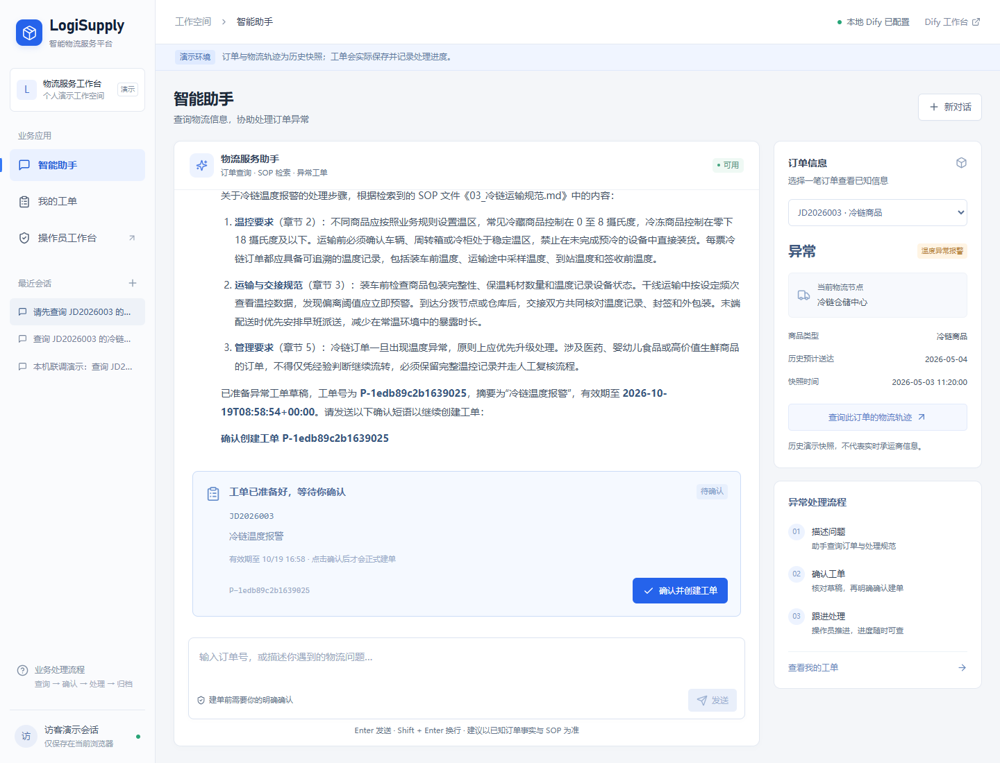

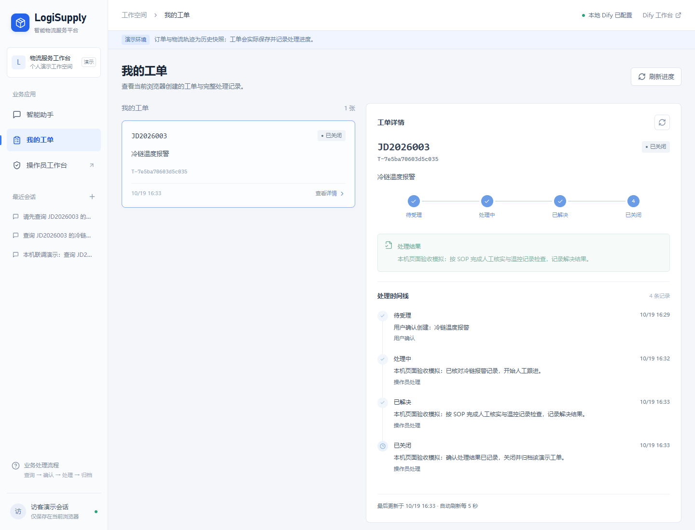

本机运行证据见 [交付报告](evaluation/results/local_delivery.json)、[API 全流程](evaluation/results/local_acceptance.json)、[实际浏览器验收](evaluation/results/local_browser_acceptance.json)和[重启持久化](evaluation/results/local_persistence.json)。订单、轨迹和操作均为模拟业务；截图不能代替实时演示。

## V2 升级

新增 Dify 经典 Agent / Function Calling 模板，由模型自主选择订单查询、轨迹查询、SOP 检索、工单草稿和进度查询工具。用户在 Dify 自带聊天页发送完整确认短语后，由独立分支创建工单；操作员使用独立接口推进处理、解决和关闭，全部事件保存在 SQLite。

- [V2 配置、部署与验收说明](dify/Agent升级与联调.md)
- [Agent Chatflow DSL](dify/logisupply_agent.dify.yml)（模型、provider 和服务地址需绑定）
- [工具 OpenAPI](dify/agent_tools.openapi.json)
- [Agent 系统指令](prompts/logistics_agent_prompt.md)
- [在线验收场景](evaluation/agent_cases.json)

当前完整运行请使用根目录 `start-local.ps1`。`python -m order_api.run_demo` 仅保留为旧工具接口调试入口，不代表完整页面和本地 Dify 已启动。

### 历史云端版本（不参与当前本机运行）

以下保留原始验收和链接，不能作为本轮本地版本证据。旧Railway运行部署已按用户要求下线，项目、配置和SQLite数据卷保留；旧Dify Cloud未改动。[下线记录](evaluation/results/railway_shutdown.json)。

2026-10-19 原云端验收：后端已部署，原 Dify 应用已发布。本地44项测试、[正式 API 工单全流程](evaluation/results/cloud_acceptance.json)、[容器重启后的数据保留](evaluation/results/cloud_persistence.json)和[正式 Web App](evaluation/results/webapp_acceptance.json)均通过。连续查询同一工单曾出现模型沿用旧状态，已通过实时查询分支修复并[回归验证](evaluation/results/cloud_status_regression.json)。尚未执行的其他在线场景在测试清单中保留 pending。

- [历史 Dify 聊天页](https://udify.app/chat/iQSkaDn48xNeqMpK)
- [历史公网后端健康检查](https://logisupply-api-production.up.railway.app/health)
- [云部署说明](docs/云端部署说明.md)

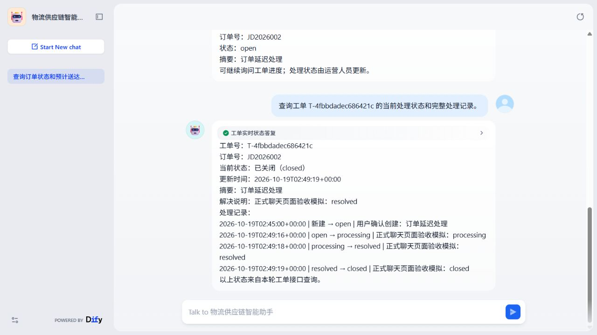

以下为保留的 V1 介绍与对照基线。

[](https://github.com/vaegod/logisupply-rag-agent/actions/workflows/ci.yml)
[](LICENSE)

## 项目简介

本项目面向物流、仓储和供应链业务场景，使用 Dify Chatflow 编排知识检索、参数提取和 HTTP 工具调用，使用 FastAPI 提供模拟订单接口。系统支持物流业务文档问答、订单状态查询和异常处理建议，并通过自建测试集建立本地基线与 Dify 端到端评测入口。

V1 实现属于路径预先定义的工作流应用。V2 新增有限工具集合上的 Agent 自主选择；工单写入仍由确定性确认分支处理。

项目聚焦业务落地与工程可复现性，重点展示以下能力：

- 物流供应链知识库问答
- 知识库答案引用来源展示
- 订单状态查询工具调用
- 异常订单处理建议生成
- 基于测试集的评测与优化

## 核心功能

### 1. 物流知识库问答

用户可以直接询问仓储、运输、冷链、退换货、盘点、异常工单升级等业务规则，系统从 Dify Knowledge 检索相关文档片段，再由大模型整理成结构化答复。

### 2. 订单状态查询

当问题中包含订单号时，Dify Chatflow 会提取订单号，调用 `FastAPI` 订单接口，并将接口返回的 JSON 整理成客服可直接使用的中文回复。

### 3. 异常处理建议

当订单出现延迟、温度异常、破损等问题时，系统会结合订单接口结果与知识库中的 SOP 文档，生成处理步骤、客户沟通话术和是否需要人工升级的建议。

### 4. 问答效果评测

仓库提供测试问题集和评测脚本，用于批量调用 Dify API，统计关键词命中和通过率，辅助优化 Prompt 与检索参数。

## 技术栈

- Dify
- RAG / Knowledge Retrieval
- Dify Chatflow / Workflow
- FastAPI
- Python
- Markdown 知识库
- CSV 测试集与评测脚本

## 系统架构

```text
用户输入问题
   ↓
Dify Chatflow
   ↓
Question Classifier
   ├── 知识库问答 → Knowledge Retrieval → LLM → Answer
   ├── 订单状态查询 → 参数提取 → HTTP Request → LLM → Answer
   ├── 异常处理建议 → 参数提取 → HTTP Request → Knowledge Retrieval → LLM → Answer
   └── 其他问题 → LLM 兜底 → Answer
```

## 项目目录

```text
.
├── README.md
├── docs/          # 物流业务知识库与项目展示文档
├── order_api/     # FastAPI 订单工具接口
├── prompts/       # Dify LLM 节点 Prompt
├── evaluation/    # 离线基线、Dify 端到端评测与结果
├── dify/          # Dify DSL、节点配置与导入说明
├── tests/         # API、DSL 与评测测试
├── .github/       # GitHub Actions CI
└── screenshots/   # 项目展示截图
```

## FastAPI 订单接口

本地启动：

```powershell
cd order_api
pip install -r requirements.txt
uvicorn main:app --host 0.0.0.0 --port 8000 --reload
```

接口列表：

- `GET /health`
- `GET /orders?order_id=...`
- `GET /orders/{order_id}`
- `POST /orders/query`
- `POST /orders/analyze`

启动后可访问：

- `http://127.0.0.1:8000/health`
- `http://127.0.0.1:8000/docs`

运行接口与评测测试：

```powershell
python -m venv .venv
.venv\Scripts\Activate.ps1
pip install -r requirements-dev.txt
python -m pytest
```

## Dify 工作流

仓库提供 Dify App DSL：

- [logisupply_chatflow.dify.yml](dify/logisupply_chatflow.dify.yml)
- [DSL 导入说明](dify/DSL导入说明.md)

DSL 包含以下节点和完整连线：

- `Question Classifier`
- `Knowledge Retrieval`
- `Parameter Extractor`
- `HTTP Request`
- `LLM`
- `Answer`

导入后仍需在用户自己的 Dify 工作区选择模型、知识库，并替换订单 API 地址。仓库不会保存模型凭证、知识库内部 ID 或临时隧道地址。

详细节点说明、Prompt 配置和联调替换项见：

- [workflow_design.md](dify/workflow_design.md)
- [dify_config_notes.md](dify/dify_config_notes.md)
- [chatflow_setup_checklist.md](dify/chatflow_setup_checklist.md)

推荐配置与已验证结果：

- 知识库问答分支：`Hybrid Search`、`Top K = 5`、`Score Threshold = 0.35`
- 异常处理建议分支：`Hybrid Search`、`Top K = 5`、`Score Threshold = 0.35`、`Rerank = Qwen/Qwen3-Reranker-8B`
- 订单查询与异常处理分支通过 Dify `HTTP Request` 节点调用 `FastAPI` 订单接口
- 订单查询分支最终推荐使用 `POST /orders/query` + JSON Body，避免 Dify 在 GET URL 路径/查询参数拼接时出现兼容问题

已验证通过的问题：

- `冷链运输温度异常怎么办？`
- `订单 JD2026001 到哪了？`
- `订单 JD2026002 延迟了怎么处理？`

## 项目截图

> HTTP 节点截图中的临时联调域名已做打码处理，仓库不保存真实临时隧道地址。

### 知识库文档

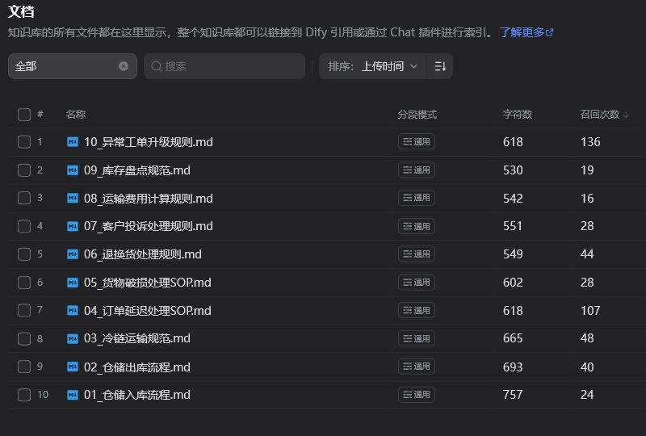

### Chatflow 工作流

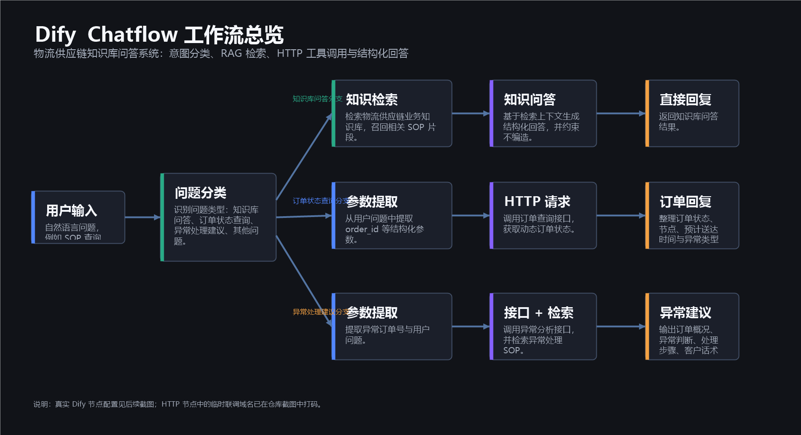

### 问题分类器

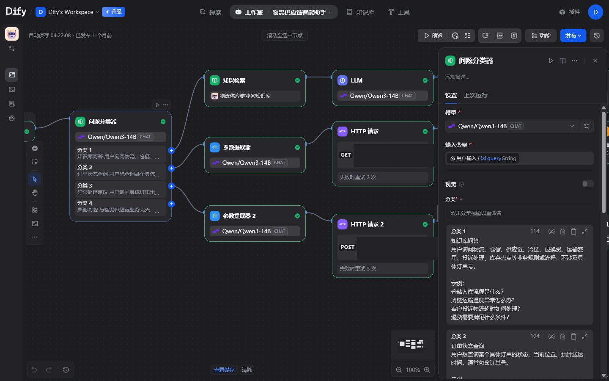

### 知识检索节点

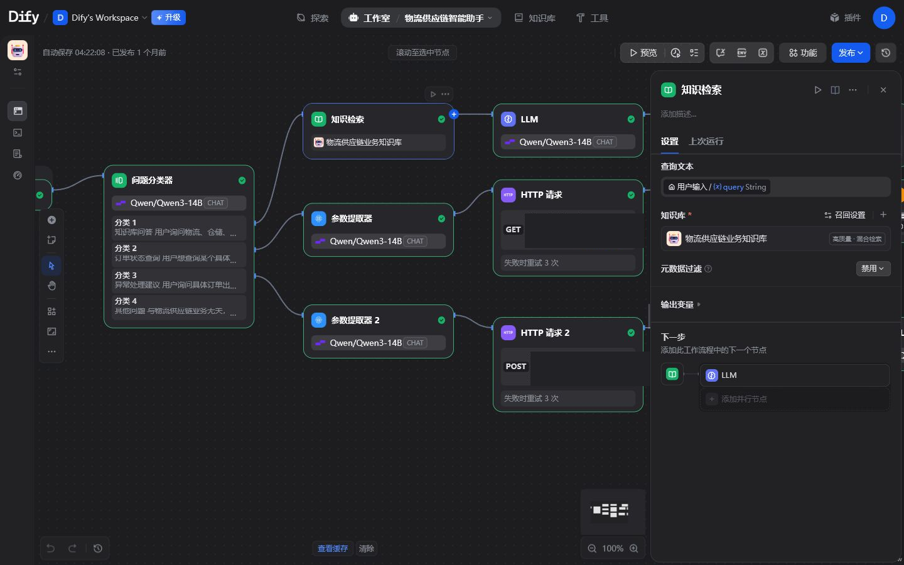

### 订单查询 HTTP 节点

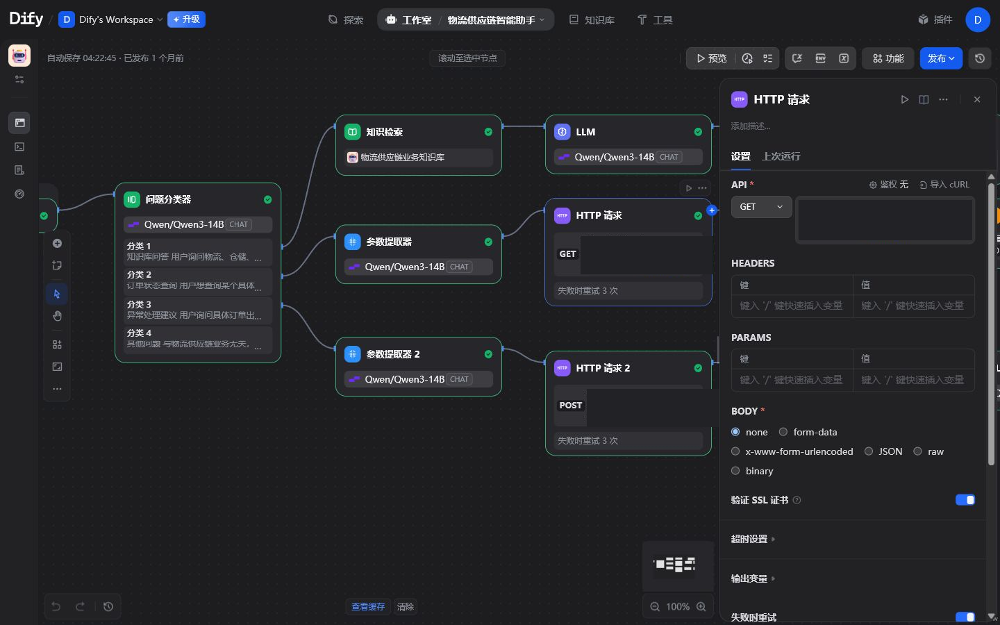

### 异常分析 HTTP 节点

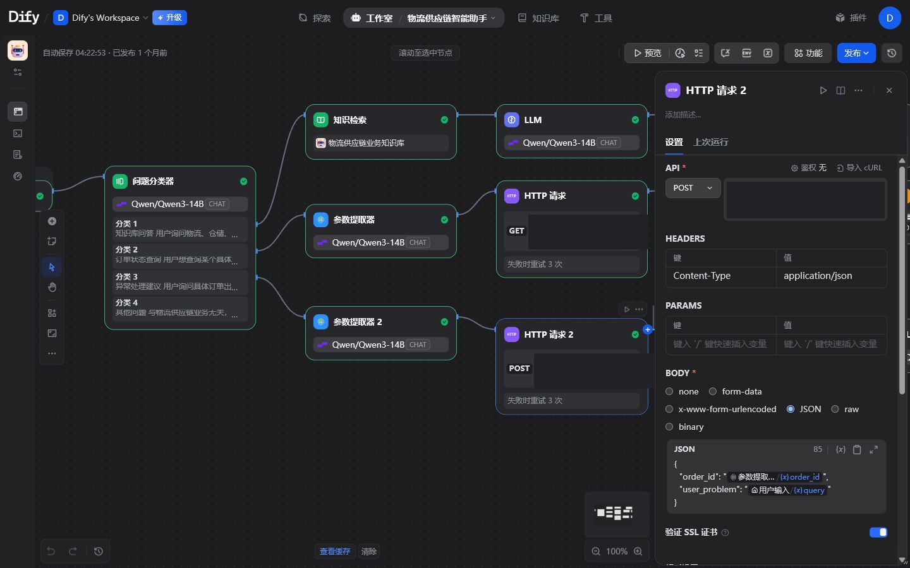

### RAG 问答预览

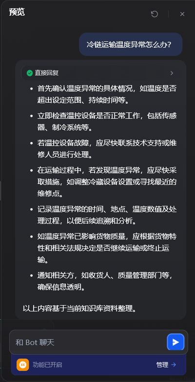

### 评测结果汇总

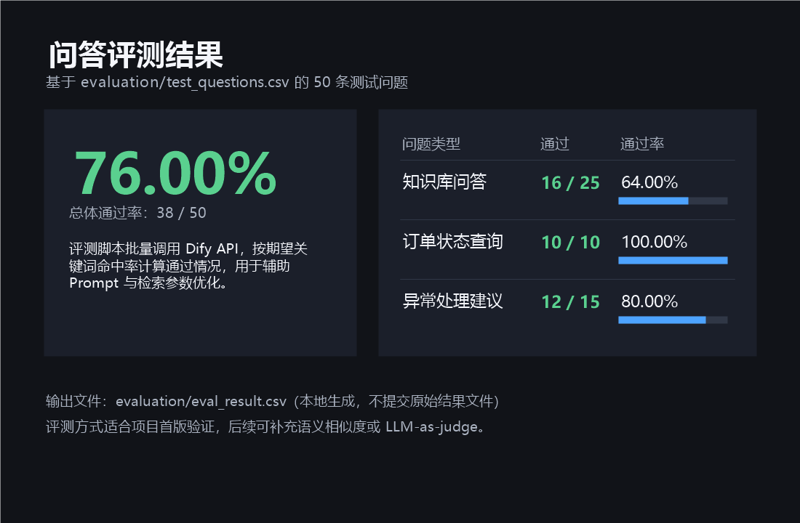

## 评测方法

### 本地可复现基线

本地评测不需要模型密钥，覆盖：

- 10 份物流 SOP 的文档级 BM25 检索。
- 25 条带目标文档标注的检索问题。
- 50 条意图路由问题。
- 24 条包含订单号的问题及本地订单工具查询。

运行：

```powershell
python evaluation/offline_eval.py --write --check
```

当前实测结果：

| 指标 | 结果 |
|---|---:|
| BM25 Recall@1 | 88.00% |
| BM25 Recall@3 | 100.00% |
| BM25 MRR | 0.9333 |
| 规则路由准确率 | 100.00% |
| 订单号提取率 | 100.00% |
| 已知订单工具查询成功率 | 100.00% |

结果文件：

- [离线指标](evaluation/results/offline_metrics.json)
- [检索逐题结果](evaluation/results/retrieval_cases.csv)
- [路由逐题结果](evaluation/results/routing_cases.csv)
- [失败与弱案例](evaluation/results/failure_cases.md)
- [迭代记录](evaluation/results/迭代记录.md)

这些指标是本地、确定性的基线，不等同于 Dify 混合检索或生成回答质量。当前仍有 3 条 BM25 Top 1 未命中、但 Top 3 成功召回的弱案例。

### Dify 端到端评测

仓库同时提供：

- `evaluation/test_questions.csv`：基础测试问题集
- `evaluation/rag_eval.py`：调用 Dify API 的评测脚本

运行方式：

```powershell
$env:DIFY_API_KEY="<DIFY_API_KEY>"
cd evaluation
python rag_eval.py
```

评测结果默认输出：

- `evaluation/eval_result.csv`：逐题回答、关键词得分、API 状态和延迟。
- `evaluation/eval_summary.json`：API 成功率、关键词通过率、平均延迟、P95 延迟和分类型结果。

说明：

- 仓库不保存 `DIFY_API_KEY`，运行前需通过环境变量注入。
- 运行 `rag_eval.py` 前，请先在 Dify 中发布当前 Chatflow 应用；未发布状态下，Dify API 会返回 `Workflow not published`。
- 当 Dify Prompt 或检索参数调整后，建议重新跑一次小样本验证，再批量执行 `rag_eval.py`。
- 端到端结果没有实际运行前，不应把本地 BM25 指标描述成 Dify RAG 效果。

## 部署与联调说明

- Dify Cloud 不能直接访问本机 `127.0.0.1`，订单接口需要使用 Dify 可访问的 HTTP 地址。
- 本地开发可通过临时隧道暴露 `order_api` 的 `8000` 端口；长期演示建议部署到稳定公网地址。
- 如接口域名变化，需要同时替换订单查询与异常处理分支中的两个 HTTP URL。
- Dify 在 HTTP URL、POST Body 和 LLM Prompt 中，优先使用变量插入器，不要依赖手写 `{{...}}` 模板字符串。
- 每次在 Dify UI 中调整 Prompt、检索参数或节点结构后，应同步回写到仓库。

## 自动化验证

GitHub Actions 在 Python 3.11 和 3.13 上执行：

- 订单 API、Dify DSL 和评测代码测试。
- 离线评测阈值回归。

当前本地测试结果为 `23 passed`。CI 徽章需要将本地修改推送到 GitHub 后才会显示本次工作流状态。

## 项目边界

- 订单数据是 JSON 模拟数据，不代表生产订单系统。
- 本地 BM25 是透明基线，不复现 Dify 的切分、向量检索或重排。
- Dify DSL 已通过 YAML 和图结构测试，但仍需在实际工作区选择模型与知识库后完成导入联调。
- 项目没有生产级鉴权、限流、监控和权限隔离。

## 项目展示文档

- [项目展示说明](docs/项目展示说明.md)
- [项目实现说明](docs/项目实现说明.md)
- [技术问答](docs/技术问答.md)

## License

[MIT License](LICENSE)
