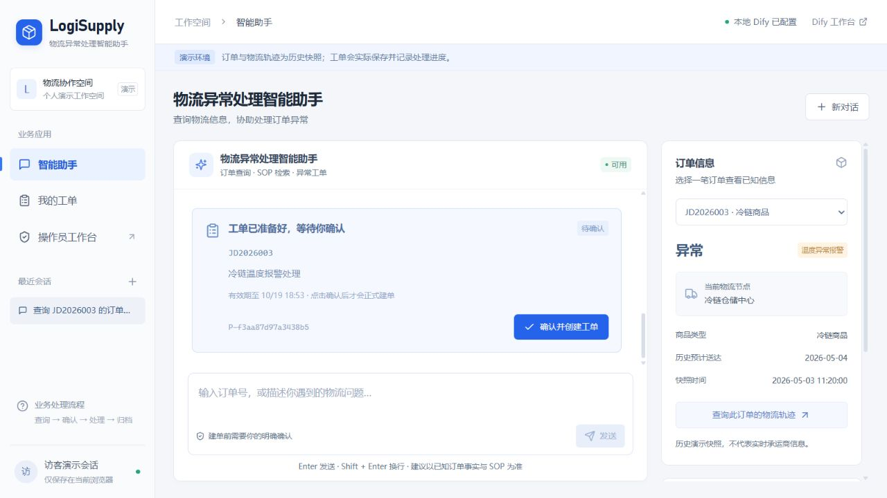
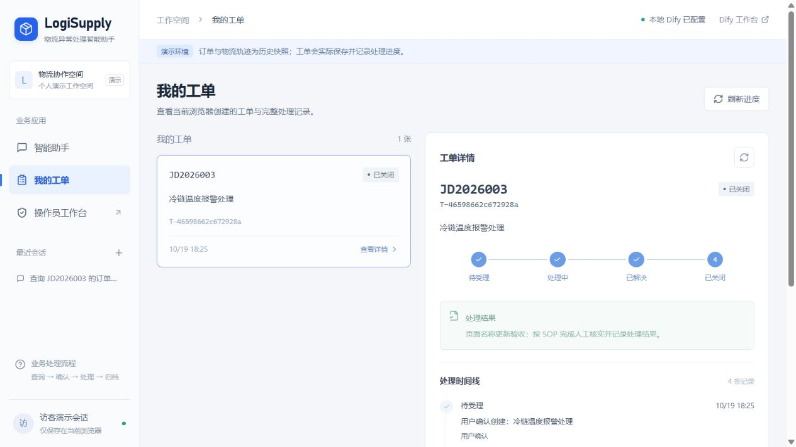

# 物流异常处理智能助手

本地 Dify Agent · Milvus 混合检索 RAG · React / FastAPI

[](https://github.com/vaegod/logisupply-rag-agent/actions/workflows/ci.yml?query=branch%3Amain)
[](LICENSE)

面向物流客服与异常处理操作员，提供订单与轨迹查询、物流 SOP 检索和异常工单协作。Agent 准备处理建议与工单草稿，用户确认后建单，操作员跟进处理、解决和关闭。

**当前运行方式：本机 Dify 1.17.1 + React/TypeScript + FastAPI + SQLite + Milvus 3.0.2。** 应用和数据库在本机 Docker 中运行，Qwen 和 Embedding 继续调用 SiliconFlow API，完成回答生成与向量化。

[本地运行说明](docs/本地运行说明.md) · [前端说明](web/README.md) · [Milvus 迁移说明](docs/Milvus迁移说明.md) · [验收报告](evaluation/results/local_delivery.json)

## 项目截图

实际本机页面：Agent 查询订单、检索 SOP 后返回文件和章节依据，页面展示从业务数据库读取的待确认草稿。



操作员独立处理异常工单，用户页面同步展示工单状态、解决说明与处理事件。



项目内置四条演示订单与十份物流 SOP，可在本机体验查询、确认建单、处理和归档流程。

## 核心能力

- **订单与轨迹查询：** 从 SQLite 读取订单状态、物流节点、预计送达时间与快照时间。
- **混合检索 RAG：** 十份 Markdown SOP 按章节切成 53 个片段，用 BAAI/bge-m3 生成 1024 维向量；BM25 与 Milvus 向量分别召回，再通过 RRF 融合，返回文件、章节与引用。向量服务或 Embedding 不可用时明确标记 BM25 降级。
- **Agent 工具编排：** Dify 经典 Agent / Function Calling 自主选择订单、轨迹、SOP、草稿和工单查询工具，最多迭代八轮。SOP 检索由 FastAPI 的 `search_sop` 工具执行。
- **用户确认建单：** 草稿卡片读取数据库记录；用户点击确认后，将完整确认短语作为新消息送入固定建单分支。固定分支执行正式建单，事务和唯一约束保证重复确认返回同一工单。
- **工单处理闭环：** 操作员独立登录，按 `open → processing → resolved → closed` 推进状态并保存事件；预期状态不一致时拒绝覆盖。用户工单页直接查询最新记录。
- **会话与流式交互：** FastAPI 同源网关保存服务密钥、校验匿名浏览器会话与操作员角色，React 通过 SSE 展示回复并在结束后回读实际草稿和工单。

## 技术栈与数据分工

| 部分 | 当前实现 | 用途 |
| --- | --- | --- |
| 前端 | React、TypeScript、Vite | 用户聊天、草稿确认、工单列表、操作员处理页 |
| 后端 | Python、FastAPI | 同源流式网关、工具接口、会话与业务校验 |
| Agent 编排 | 本机 Dify 1.17.1 | 模型接入、有限工具选择、确认与状态查询固定分支 |
| 生成与向量化 | Qwen/Qwen3-14B、BAAI/bge-m3 API | 根据工具事实与制度片段组织回答、生成查询向量 |
| 业务数据 | SQLite | 订单、草稿、工单、事件与网页会话 |
| 制度检索 | BM25、Milvus 3.0.2、RRF | 当前使用 FLAT + COSINE 精确向量检索与排名融合 |
| 平台与部署 | Docker Compose、WSL、Dify PostgreSQL/Redis | 运行本机服务、保存 Dify 平台配置和任务状态 |

浏览器访问 FastAPI；FastAPI 调用本机 Dify；Dify 工具再访问同一个业务容器，页面与工具共用同一份 SQLite。Milvus 只保存制度片段及其向量，订单事实和工单状态仍通过业务接口精确读取。

## 快速开始

当前启动脚本面向 **Windows + PowerShell + Python 3.13+ + WSL `Ubuntu-24.04`**，Docker Engine 和 Docker Compose 需要在该 WSL 环境中可用。首次下载镜像与安装官方 Agent/模型插件需要联网，耗时取决于网络。

```powershell
git clone https://github.com/vaegod/logisupply-rag-agent.git
cd logisupply-rag-agent
Copy-Item .env.example .env

# 编辑 .env，填写 SiliconFlow 的 EMBEDDING_API_KEY。
# 可单独填写 LLM_API_KEY；留空时，本机初始化会复用 Embedding 密钥。
# 然后首次启动：
.\start-local.ps1 -Install
```

已有 `.env` 时，直接补充所需的模型密钥。本机初始化会生成 Dify 管理账号、工具密钥和操作员口令，导入并发布本地 Agent，并显式检查或构建 SOP 索引。

| 入口 | 本机地址 |
| --- | --- |
| 用户工作台 | http://127.0.0.1:8020 |
| 操作员工作台 | http://127.0.0.1:8020/operator |
| Dify 工作台 | http://127.0.0.1:8088 |
| 业务健康检查 | http://127.0.0.1:8020/health |
| Milvus SDK 服务 | http://127.0.0.1:19530 |

**Dify 账号和操作员口令：** 启动后查看本机 `dify/local/selfhost/本机访问说明.txt`。账号、口令和服务密钥统一保存在本机配置目录。

日常管理：

```powershell
.\start-local.ps1    # 启动或更新本机服务
.\status-local.ps1   # 查看容器状态
.\stop-local.ps1     # 停止本项目服务，保留数据
```

业务 SQLite 位于 Docker 卷 `logisupply-dify_business_data`，Milvus 位于 `logisupply-milvus_milvus_data`，Dify 平台数据使用自己的命名卷。详细配置、持久化、排障和备份注意事项见[本地运行说明](docs/本地运行说明.md)。

## 演示一次完整流程

1. 在用户工作台输入：“查询 JD2026003 的冷链温度异常，检索处理 SOP，给出文件和章节依据，并准备工单草稿，暂时不要建单。”
2. 核对订单快照、制度依据和数据库草稿卡片，再点击“确认并创建工单”。
3. 使用本机操作员口令登录，依次受理、解决和关闭工单，填写处理备注。
4. 返回“我的工单”，查看最新状态及四条处理事件；也可使用完整工单号在聊天中查询。

草稿卡片直接读取数据库记录，确认结果与处理事件同步保存；浏览器 Cookie 用于关联会话和工单。

## 测试与验证

GitHub Actions 在 Python 3.11、3.13 上运行后端测试与离线基线，并单独运行前端测试和构建。

| 验证层次 | 已有结果 | 对应证据 |
| --- | --- | --- |
| 后端程序回归 | 79 项通过，保留严格工具定义一致性检查 | [依赖统一后的回归](evaluation/results/dependency_alignment_tests.xml) |
| 前端与构建 | 3 项流解析测试通过，TypeScript/Vite 构建通过 | [GitHub CI](https://github.com/vaegod/logisupply-rag-agent/actions/workflows/ci.yml?query=branch%3Amain) |
| 真实本机 Dify API | 草稿、确认幂等、隔离、操作员关闭与冲突拒绝通过 | [API 验收](evaluation/results/local_acceptance.json) |
| 实际浏览器 | SOP 引用、可信卡片、点击确认、操作员处理与用户进度通过 | [浏览器验收](evaluation/results/local_browser_acceptance.json) |
| 停止再启动 | 业务事件、网页会话、Dify 调用与 Milvus 索引保留 | [持久化验收](evaluation/results/local_persistence.json) |

本地复验：

```powershell
.venv\Scripts\python.exe -m pytest
.venv\Scripts\python.exe evaluation/offline_eval.py --check
cd web
npm ci
npm test
npm run build
cd ..

# 下列命令会真实调用模型 API，并创建后关闭一张模拟工单：
.venv\Scripts\python.exe evaluation/local_acceptance.py
```

在 35 道固定检索开发题上，整篇 BM25 与章节混合检索的来源命中结果如下。

| 检索方式 | Top-1 来源命中 | Top-3 来源命中 |
| --- | --- | --- |
| 整篇 BM25 | 28/35 | 35/35 |
| 章节 BM25 + Milvus + RRF | 33/35 | 35/35 |

逐题结果、召回列表和评分口径见[检索报告](evaluation/results/hybrid_retrieval.json)。

## 主要目录

| 位置 | 内容 |
| --- | --- |
| `web/` | React 工作台、数据契约与流解析 |
| `order_api/` | FastAPI 网关、业务数据库、状态机与混合检索 |
| `deploy/dify/`、`deploy/milvus/` | 本机编排、初始化、代理与向量服务配置 |
| `dify/`、`prompts/` | Agent 生成器、可分享模板、工具定义和系统指令 |
| `docs/` | 十份编号 SOP、运行说明和迁移说明 |
| `evaluation/`、`tests/` | 检索对比、真实链路验收与程序回归 |
| `output/playwright/` | 实际本机页面与下线证明截图 |

## 版本与开发文档

- [本地运行说明](docs/本地运行说明.md)：环境配置、启动入口、数据持久化与排障。
- [Milvus 迁移说明](docs/Milvus迁移说明.md)：集合结构、索引版本、混合检索与降级机制。
- [Agent 配置与联调](dify/Agent升级与联调.md)：工具绑定、工作流节点与工单流程。
- [版本演进记录](docs/历史版本/README演进存档_20261019.md)：固定工作流、全栈页面和本机部署的演进过程。

## License

[MIT License](LICENSE)
